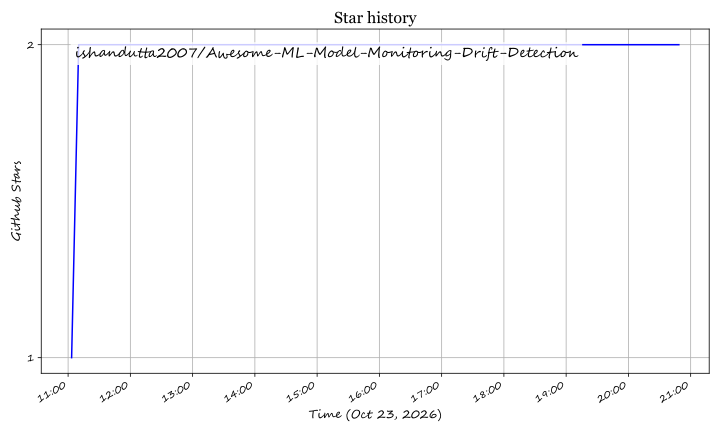

<p align="center">
  
</p>

# 🚀 Awesome ML Model Monitoring & Drift Detection

<p align="center">
  <a href="https://github.com/ishandutta2007/Awesome-Awesome-Awesome"></a><a href="https://discord.gg/jc4xtF58Ve"></a> <a href="https://github.com/ishandutta2007/Awesome-ML-Model-Monitoring-Drift-Detection/stargazers"></a> <a href="https://github.com/ishandutta2007/Awesome-ML-Model-Monitoring-Drift-Detection/network/members"></a> <a href="https://github.com/ishandutta2007/Awesome-ML-Model-Monitoring-Drift-Detection/blob/main/LICENSE"></a> <a href="https://makeapullrequest.com"></a> <a href="https://github.com/ishandutta2007"></a>
</p>

---

## 📌 Introduction & Overview

Welcome to the definitive, community-curated landscape for **Machine Learning (ML) Model Monitoring, AI Observability, and Data Drift Detection**.

When machine learning models and Large Language Models (LLMs) transition into production environments, standard APM tools like CPU or latency alerts are fundamentally inadequate. Models fail silently: input distributions shift, consumer behaviors mutate, external APIs change their formats, and upstream pipelines corrupt features. The model keeps returning `200 OK` predictions, but their real-world predictive validity has quietly deteriorated.

This repository systematically indexes the top **SaaS platforms** and **open-source frameworks** tailored for production ML practitioners, data scientists, and MLOps engineers who require:
- **Data Drift & Covariate Shift Detection** (KS-Test, PSI, Wasserstein Distance, Chi-Square)
- **Concept Drift & Prior Probability Shift**
- **Silent Failure Prevention & Ground-Truth-Independent Performance Estimation** (CBPE, DLE)
- **Intelligent Alert Fatigue Mitigation**
- **LLM Tracing, Token Telemetry, and Guardrail Observability**

---

## 📑 Table of Contents

- [🌐 Sector Overview & Market Dynamics](#-sector-overview--market-dynamics)
- [🏢 Enterprise SaaS & Hosted Platforms](#-enterprise-saas--hosted-platforms)
  - [SaaS Comparative Matrix](#saas-comparative-matrix)
  - [SaaS Deep Dive](#saas-deep-dive)
- [💻 Open-Source GitHub Projects](#-open-source-github-projects)
  - [Open-Source Ranking by Stars](#open-source-ranking-by-stars)
  - [Open-Source Deep Dive](#open-source-deep-dive)
- [🧠 Core Concepts: Drift Detection & Silent Failure Taxonomy](#-core-concepts-drift-detection--silent-failure-taxonomy)
- [🛠️ How to Contribute](#️-how-to-contribute)
- [⚖️ Disclaimer & Evaluation Guidelines](#️-disclaimer--evaluation-guidelines)
- [📈 Star History](#-star-history)
- [💖 Support & Sponsorship](#-support--sponsorship)

---

## 🌐 Sector Overview & Market Dynamics

The global market for **AI Observability, ModelOps, and ML Model Monitoring** is estimated at **$1.8 Billion to $2.5 Billion in 2024–2025**, expanding at an aggressive Compound Annual Growth Rate (**CAGR**) of **22.8% to 40.5%**, and is projected to surpass **$10 Billion to $30 Billion by 2030–2032** as enterprise artificial intelligence initiatives transition from experimental sandboxes to mission-critical revenue drivers.

The sector is currently **moderately to highly fragmented**, characterized by a vibrant cohort of specialized pure-play innovators (such as Arize AI, Fiddler AI, Arthur AI, Aporia, and WhyLabs) advancing cutting-edge research in confidence-based estimation, non-parametric multivariate drift testing, and agentic LLM tracing, while contending with and being targeted for strategic acquisition by incumbent Application Performance Monitoring (APM) and cloud infrastructure powerhouses (such as Datadog, Dynatrace, New Relic, and Coralogix) seeking to consolidate machine learning telemetry into unified enterprise observability dashboards.

---

## 🏢 Enterprise SaaS & Hosted Platforms

Enterprise SaaS platforms eliminate self-hosted infrastructure overhead, provide enterprise Single Sign-On (SSO) / Role-Based Access Control (RBAC), and deliver end-to-end alerting integrations out-of-the-box.

### SaaS Comparative Matrix

*Platforms are sorted in descending order based on Company Valuation / Market Capitalization.*

| 🏷️ Platform | 💰 Company Size / Valuation / Revenue | ⚡ Key Capabilities & Specialty | 💳 Pricing (Starting Tier) | 🎁 Free Tier Limits |
| :--- | :--- | :--- | :--- | :--- |
| **[Datadog LLM & ML Observability](https://www.datadoghq.com/product/llm-observability/)** | **~$90 Billion Market Cap** (~$3.43B FY2025 Revenue) | Unified full-stack APM, agent tracing, latency/token cost tracking, and automated drift alerts across cloud infrastructure. | **$160 / month** (Base Pro plan bundling 100,000 LLM spans; extra spans billed on ingestion volume). | **14-day free trial** with full platform feature access (unlimited hosts, spans, and metric queries during trial). |
| **[Arize AI (AX)](https://arize.com/)** | **$915 Million Valuation** ($131M venture funding; acquired by Dynatrace) | Auto-thresholding alerts, API-triggered monitors for CI/CD pipelines, Apache Iceberg Data Fabric sync every 60 min, and LLM tracing. | **$50 / month** (AX Pro tier with ~50,000 trace spans/mo, 10 GB ingestion, and 30-day retention). | **Free Forever (AX Free)**: Up to 25,000 trace spans/mo, 1 GB ingestion volume, 15-day data retention, 10 Signal issues/mo, and unlimited evaluations. |
| **[Arthur AI](https://www.arthur.ai/)** | **$150 Million+ Valuation** ($65M+ venture funding raised across Series A/B) | Enterprise drift monitoring, explainability, bias/fairness auditing, custom firewall rules, and model performance decay detection. | **$60 / month** (Premium tier with up to 100 model use-cases, 30-day data retention, custom alerts, and webhooks). | **Free Forever**: Up to 4 active model use cases, core metric performance tracking, cloud data connectors, and 7-day data retention. |
| **[Fiddler AI](https://www.fiddler.ai/)** | **~$120M–$150M Est. Valuation** ($94M–$100M venture funding raised through Series C) | Explainability-first model monitoring, sub-80ms real-time guardrails, multi-column comparison charts, and embedded root-cause diagnostics. | **$0.002 per trace** (Developer Plan with unified predictive & agentic observability, custom evaluators, RBAC, and SSO). | **Free Forever**: Real-time LLM guardrails (sub-80ms latency) protecting against hallucinations, jailbreaks, PII/PHI leakage, and prompt injections. |
| **[Aporia](https://www.aporia.com/)** | **$50M Acquisition / $100M Peak Valuation** ($30M venture funding; acquired by Coralogix; ~$8.4M ARR) | Real-time AI guardrails, customizable ML metrics, zero-data-sampling architecture, and automated drift investigation workflows. | **$150 / month** (Starter Plan for real-time model monitoring, data drift tracking, and customizable alerts). | **14-day free trial** with full access to live AI guardrails, drift alerts, and risk mitigation across all models. |
| **[WhyLabs](https://whylabs.ai/)** | **$37 Million Valuation** ($14M venture funding; core team acquired by Apple) | AI observability powered by statistical profiles, data constraint validations, and cross-environment log merging without raw data exposure. | **$125 / month** (Expert Plan for tracking multi-model resources, custom alerting thresholds, and scheduled reports). | **Free Forever (Starter Plan)**: 1 active model resource, up to 1,000,000 statistical profiles/month, 30-day data retention, and 1 user seat. |

---

### SaaS Deep Dive

#### 1. 🐕 Datadog (LLM & ML Observability)
- **Primary Strength:** Enterprise-wide consolidation of traditional cloud infrastructure metrics with machine learning inference logs and LLM span traces.
- **Drift & Monitoring Mechanics:** Evaluates inference token latency, token usage volume, input length anomalies, and error rates in lockstep with underlying Kubernetes or GPU infrastructure metrics.
- **Enterprise Integrations:** Native connectors to OpenAI, AWS Bedrock, Anthropic Claude, LangChain, and Triton Inference Server.
- **Best Suited For:** Teams already leveraging Datadog infrastructure monitoring that want a single unified pane of glass for APM and machine learning operations.

#### 2. 🦅 Arize AI (AX)
- **Primary Strength:** Managed observability platform marrying classical ML predictive monitoring with LLM agent evaluation and tracing.
- **Drift & Monitoring Mechanics:** Auto-threshold options statistically calculate drift boundaries from historical baselines without manual heuristic guesswork. API-Triggered Monitors evaluate on-demand during CI/CD or post-retraining runs.
- **Data Architecture:** Data Fabric continuously synchronizes production inference traces to enterprise data lakes in Apache Iceberg format at 60-minute intervals.
- **Best Suited For:** Mid-market and enterprise data teams running predictive pipelines alongside generative AI workflows who require managed scalability.

#### 3. 🛡️ Arthur AI
- **Primary Strength:** Heavy focus on enterprise compliance, model explainability, algorithmic bias detection, and real-time defense.
- **Drift & Monitoring Mechanics:** Computes multi-dimensional statistical distance between training distributions and live inferences; flags disparate impact across demographic segments.
- **Governance Tools:** Includes built-in audit trails for regulated sectors (finance, insurance, healthcare) requiring model risk management compliance.
- **Best Suited For:** Highly regulated industries requiring deep fairness, transparency, and automated risk scoring.

#### 4. 🎻 Fiddler AI
- **Primary Strength:** Deep root-cause explainability paired with sub-80ms real-time security guardrails.
- **Drift & Monitoring Mechanics:** Monitoring visualization charts support up to 20 columns and 6 concurrent metric queries per chart for multi-model benchmarking. Raw chart telemetry is directly exportable to CSV or Parquet.
- **Safety Engine:** Centor Models detect prompt injections, hallucinations, toxicity, and unauthorized PII extraction in real time.
- **Best Suited For:** Engineering teams demanding granular explainability and root-cause debugging alongside drift alerts.

#### 5. ⚡ Aporia
- **Primary Strength:** Transparent, zero-data-sampling architecture ensuring sensitive inference payloads never breach compliance perimeters.
- **Drift & Monitoring Mechanics:** Real-time metrics engine tracking concept drift, data corruption, and accuracy drops across tabular, NLP, and vision models.
- **Remediation:** Provides pre-built automated playbooks triggering retraining pipelines or falling back to deterministic business logic upon drift detection.
- **Best Suited For:** Privacy-stringent environments that cannot send raw inference records to third-party endpoints.

#### 6. 📊 WhyLabs
- **Primary Strength:** Privacy-preserving, distributed monitoring built upon the mathematical foundation of mergeable statistical profiles (`whylogs`).
- **Drift & Monitoring Mechanics:** Zero raw data ever leaves the VPC; lightweight mathematical summaries (sketches) capture exact data distributions, quantiles, and missingness.
- **CI/CD Integration:** Enforces data assertions and schema constraints directly inside automated data pipelines to block corrupt batches before deployment.
- **Best Suited For:** Distributed streaming pipelines and big-data workflows where bandwidth and privacy prevent centralizing raw inference logs.

---

## 💻 Open-Source GitHub Projects

Open-source frameworks allow engineering teams to retain 100% control over telemetry data, deploy within private clouds or air-gapped environments, and tailor drift detection algorithms to custom mathematical specifications without recurring SaaS seat charges.

### Open-Source Ranking by Stars

*Repositories are sorted in descending order based on their GitHub stargazer count.*

| 🏆 Rank | 📦 Repository & Stargazers | 📜 License | 🎯 Primary Domain | 💡 Core Differentiator |
| :---: | :--- | :---: | :--- | :--- |
| **#1** | **[Arize Phoenix](https://github.com/Arize-ai/phoenix)** [](https://github.com/Arize-ai/phoenix/stargazers) | Apache-2.0 | LLM Tracing & Drift | OpenTelemetry-native tracing, embedding drift visualization, and local evaluation. |
| **#2** | **[Great Expectations](https://github.com/great-expectations/great_expectations)** [](https://github.com/great-expectations/great_expectations/stargazers) | Apache-2.0 | Data Quality & Testing | Declarative assertions for data pipelines, automated profiling, and drift gatekeeping. |
| **#3** | **[Cleanlab](https://github.com/cleanlab/cleanlab)** [](https://github.com/cleanlab/cleanlab/stargazers) | AGPL-3.0 | Data-Centric AI & OOD | Out-of-distribution (OOD) detection, label noise auditing, and data health scoring. |
| **#4** | **[Evidently](https://github.com/evidentlyai/evidently)** [](https://github.com/evidentlyai/evidently/stargazers) | Apache-2.0 | ML & LLM Evaluation | 100+ built-in metrics, interactive dashboard UI, and CI/CD test suites. |
| **#5** | **[Giskard](https://github.com/Giskard-AI/giskard)** [](https://github.com/Giskard-AI/giskard/stargazers) | Apache-2.0 | ML/LLM Quality Testing | Automated vulnerability scanning, performance degradation, and bias tests. |
| **#6** | **[Deepchecks](https://github.com/deepchecks/deepchecks)** [](https://github.com/deepchecks/deepchecks/stargazers) | Apache-2.0 | Continuous Validation | Comprehensive suites for data integrity, distribution shifts, and model decay. |
| **#7** | **[whylogs](https://github.com/whylabs/whylogs)** [](https://github.com/whylabs/whylogs/stargazers) | Apache-2.0 | Mergeable Profiling | Sub-millisecond statistical profiling, mergeable sketch summaries, and data constraints. |
| **#8** | **[alibi-detect](https://github.com/SeldonIO/alibi-detect)** [](https://github.com/SeldonIO/alibi-detect/stargazers) | BSL 1.1 | Outlier & Drift Primitives | Multi-modal drift algorithms (tabular, text, image, timeseries) on PyTorch & TensorFlow. |
| **#9** | **[UpTrain](https://github.com/uptrain-ai/uptrain)** [](https://github.com/uptrain-ai/uptrain/stargazers) | Apache-2.0 | LLM Evaluation & Tracing | 20+ automated evaluation metrics, embedding drift detection, and root-cause analysis. |
| **#10** | **[NannyML](https://github.com/NannyML/nannyml)** [](https://github.com/NannyML/nannyml/stargazers) | Apache-2.0 | Silent Failure Estimation | CBPE & DLE estimation without ground truth, multivariate PCA drift, and alert ranking. |
| **#11** | **[Argus SDK](https://github.com/m-c-frank/argus-sdk)** [](https://github.com/m-c-frank/argus-sdk/stargazers) | MIT | Derived-Signal LLM Drift | Private drift detection using token/latency telemetry without prompt exposure. |
| **#12** | **[MCP ML Monitor](https://github.com/ishandutta2007/Awesome-ML-Model-Monitoring-Drift-Detection)** [](https://github.com/ishandutta2007/Awesome-ML-Model-Monitoring-Drift-Detection/stargazers) | MIT | Agent-Driven Auto-Remediation | MCP agent orchestrating KS-Test, PSI, and automated Kubernetes rollback playbooks. |

---

### Open-Source Deep Dive

#### 1. [Arize Phoenix](https://github.com/Arize-ai/phoenix) [](https://github.com/Arize-ai/phoenix/stargazers)
- **License:** Apache 2.0
- **Architectural Approach:** Phoenix is an OpenTelemetry-based AI observability framework built specifically for evaluating LLMs, agents, and generative AI systems.
- **Drift & Telemetry Capabilities:** Visualizes high-dimensional embedding drift through UMAP clustering, tracks prompt and response token degradation, and correlates semantic drift with downstream task performance.
- **Why It Matters:** Run completely locally with zero telemetry egress, or scale in containerized infrastructure with pre-built evaluation benchmarks (hallucination, QA correctness, toxicity).

#### 2. [Great Expectations](https://github.com/great-expectations/great_expectations) [](https://github.com/great-expectations/great_expectations/stargazers)
- **License:** Apache 2.0
- **Architectural Approach:** The industry standard for declarative data assertion and pipeline validation. Translates domain assumptions into self-documenting executable test suites.
- **Drift & Telemetry Capabilities:** Detects schema mutations, missing value spikes, quantile deviations, and statistical distribution shifts across SQL databases, Pandas, Polars, and Apache Spark.
- **Why It Matters:** Acts as the first line of defense before inference pipelines run, preventing corrupted features from silently poisoning model outputs.

#### 3. [Cleanlab](https://github.com/cleanlab/cleanlab) [](https://github.com/cleanlab/cleanlab/stargazers)
- **License:** AGPL 3.0
- **Architectural Approach:** Standard-bearer for Data-Centric AI (DCAI), focusing on dataset health, label errors, and out-of-distribution (OOD) inference samples.
- **Drift & Telemetry Capabilities:** Calculates confident learning scores to identify samples where model predictions diverge fundamentally from training distribution manifolds.
- **Why It Matters:** Enables ML engineers to separate algorithmic degradation from contaminated or mislabeled input data during continuous monitoring loops.

#### 4. [Evidently](https://github.com/evidentlyai/evidently) [](https://github.com/evidentlyai/evidently/stargazers)
- **License:** Apache 2.0
- **Architectural Approach:** The most complete open-source library for evaluating, testing, and monitoring classical ML models and LLMs from development through production.
- **Drift & Telemetry Capabilities:** Packed with 100+ built-in metrics spanning univariate feature drift (Wasserstein, KS-Test, PSI, Jensen-Shannon), prediction drift, target drift, classification quality, and LLM judge evaluations.
- **Production Artifacts:** Generates interactive standalone HTML reports, exports structured JSON/dictionaries for CI/CD assertions, and powers a self-hosted live monitoring dashboard service.

#### 5. [Giskard](https://github.com/Giskard-AI/giskard) [](https://github.com/Giskard-AI/giskard/stargazers)
- **License:** Apache 2.0
- **Architectural Approach:** Automated testing and QA framework specifically engineered to detect regressions, domain shifts, and ethical vulnerabilities in machine learning models and generative agents.
- **Drift & Telemetry Capabilities:** Generates adversarial test cases automatically to uncover performance drops on unseen demographic slices and evaluates robustness against semantic perturbations.
- **Why It Matters:** Bridges the gap between static offline validation and production monitoring by enforcing test suites in CI/CD before models reach serving clusters.

#### 6. [Deepchecks](https://github.com/deepchecks/deepchecks) [](https://github.com/deepchecks/deepchecks/stargazers)
- **License:** Apache 2.0
- **Architectural Approach:** Holistic validation library providing plug-and-play check suites across data integrity, train-test leakage, distribution drift, and model performance decay.
- **Drift & Telemetry Capabilities:** Comprehensive checks for categorical outlier detection, feature-label correlation drift, and unseen categories appearing in live production data.
- **Why It Matters:** Provides out-of-the-box suites that can be embedded into retraining loops, pipeline stages, and production inference monitors with a single Python function call.

#### 7. [whylogs](https://github.com/whylabs/whylogs) [](https://github.com/whylabs/whylogs/stargazers)
- **License:** Apache 2.0
- **Architectural Approach:** The gold standard in lightweight statistical profiling. Constructs approximate, mergeable mathematical sketches of streaming or batch datasets.
- **Drift & Telemetry Capabilities:** Tracks distributions, cardinalities, missingness, and data types with sub-millisecond execution times and zero storage of raw customer inputs.
- **Distributed Mergeability:** Profiles generated across multiple distributed worker nodes (Spark, Ray, Kubernetes pods) can be merged algebraically without loss of statistical precision.

#### 8. [alibi-detect](https://github.com/SeldonIO/alibi-detect) [](https://github.com/SeldonIO/alibi-detect/stargazers)
- **License:** Business Source License 1.1 (BSL 1.1)
- **Architectural Approach:** Rigorous statistical library focused on algorithms for outlier detection, adversarial perturbation detection, and dataset drift.
- **Drift & Telemetry Capabilities:** Implements Maximum Mean Discrepancy (MMD), Kolmogorov-Smirnov (KS), Learned Kernel MMD, and Chi-Square tests across tabular data, natural language, computer vision images, and time series.
- **Backends:** Deep integration with PyTorch and TensorFlow for autoencoder-based reconstruction error and latent-space drift detectors.

#### 9. [UpTrain](https://github.com/uptrain-ai/uptrain) [](https://github.com/uptrain-ai/uptrain/stargazers)
- **License:** Apache 2.0
- **Architectural Approach:** Observability and continuous evaluation toolkit focused on debugging LLMs, RAG pipelines, and ML systems in production.
- **Drift & Telemetry Capabilities:** Provides 20+ automated evaluation metrics including context relevance, factual accuracy, language fluency, and embedding distance shift over time.
- **Root-Cause Analysis:** Flags edge-case failures and groups anomalous inference requests into semantic clusters for targeted retraining.

#### 10. [NannyML](https://github.com/NannyML/nannyml) [](https://github.com/NannyML/nannyml/stargazers)
- **License:** Apache 2.0
- **Architectural Approach:** The industry pioneer in **silent failure detection** and **ground-truth-independent performance estimation**.
- **Ground-Truth Estimation:**
  - **CBPE (Confidence-Based Performance Estimation):** Mathematically estimates classification performance metrics (ROC-AUC, F1-Score, Precision, Recall) when actual ground-truth labels are delayed by days, weeks, or months (e.g., credit underwriting, fraud detection).
  - **DLE (Direct Loss Estimation):** Uses machine learning to directly estimate regression performance (MAE, MSE, RMSE) in delayed-outcome production pipelines.
- **Multivariate Drift:** Employs PCA reconstruction error to monitor multi-feature interactions simultaneously, ensuring alerts are only triggered when drift directly threatens predictive accuracy (eliminating alert fatigue).

#### 11. [Argus SDK](https://github.com/m-c-frank/argus-sdk) [](https://github.com/m-c-frank/argus-sdk/stargazers)
- **License:** MIT
- **Architectural Approach:** Ultra-lightweight LLM drift detection engine that functions entirely on **derived telemetry signals** (completion latency, output token volume, finish reasons) without ever inspecting prompt or completion payload strings.
- **Statistical Mechanics:** Utilizes Welford's online algorithm to establish baseline statistics after 200 events; evaluates dynamic windows via the Mann-Whitney U test with Bonferroni correction every 60 seconds.
- **Hysteresis State Machine:** Suppresses flapping alerts with a hysteresis threshold (trips alert at drift score 0.7; requires three consecutive clean windows below 0.4 to clear).

#### 12. [MCP ML Monitor](https://github.com/ishandutta2007/Awesome-ML-Model-Monitoring-Drift-Detection) [](https://github.com/ishandutta2007/Awesome-ML-Model-Monitoring-Drift-Detection/stargazers)
- **License:** MIT
- **Architectural Approach:** Model Context Protocol (MCP) native agent integrating Kolmogorov-Smirnov (KS-Test), Population Stability Index (PSI), and Wasserstein statistical monitors into agentic reasoning loops.
- **Automated Remediation:** Integrates directly with LangFlow pipelines to trigger automated Kubernetes deployment rollbacks, dispatch Slack telemetry alerts, and file diagnostic GitHub issues upon drift detection.

---

## 🧠 Core Concepts: Drift Detection & Silent Failure Taxonomy

Understanding the statistical nature of production model degradation is crucial when configuring alerting thresholds:

```
                  ┌───────────────────────────────────────────────┐
                  │              Production Inference              │
                  └──────────────────────┬────────────────────────┘
                                         │
                 ┌───────────────────────┴───────────────────────┐
                 ▼                                               ▼
    ┌─────────────────────────┐                     ┌─────────────────────────┐
    │     Data Drift (P(X))   │                     │    Concept Drift (P(Y|X))│
    ├─────────────────────────┤                     ├─────────────────────────┤
    │ Distribution of input   │                     │ Statistical relationship│
    │ features changes over   │                     │ between inputs & targets│
    │ time (e.g. inflation,   │                     │ shifts (e.g. pandemic   │
    │ sensor hardware wear).  │                     │ changes spending habits)│
    └────────────┬────────────┘                     └────────────┬────────────┘
                 │                                               │
                 ▼                                               ▼
    ┌─────────────────────────┐                     ┌─────────────────────────┐
    │ Statistical Tests:      │                     │ Performance Estimation: │
    │ • KS-Test (Numerical)   │                     │ • CBPE (Classification) │
    │ • Chi-Square (Categ.)   │                     │ • DLE (Regression)      │
    │ • PSI (Binned Stability)│                     │ • True Label Delay Match│
    │ • Wasserstein Distance  │                     │ • Multivariate PCA Recon│
    └─────────────────────────┘                     └─────────────────────────┘
```

### Statistical Tests at a Glance

1. **Population Stability Index (PSI):**
   - Bins numerical or categorical features and measures shifts in relative population proportions between reference and inference datasets.
   - Rules of thumb: $\text{PSI} < 0.1$ (No significant shift), $0.1 \le \text{PSI} \le 0.25$ (Moderate drift, investigate), $\text{PSI} > 0.25$ (Significant drift, retrain model).
2. **Kolmogorov-Smirnov Test (KS-Test):**
   - Non-parametric statistical hypothesis test comparing the empirical cumulative distribution functions (eCDFs) of reference and production continuous variables.
   - Flags drift when the resulting p-value falls below a predefined significance threshold (typically $\alpha = 0.05$ or with Bonferroni correction for multiple features).
3. **Wasserstein Distance (Earth Mover's Distance):**
   - Quantifies the minimum work required to transform one probability distribution into another. Retains dimensional scale, making it intuitive for numeric features.
4. **Multivariate Reconstruction Error (PCA / Autoencoder):**
   - Captures subtle shifts across correlations among multiple features simultaneously that univariate tests miss.

---

## 🛠️ How to Contribute

We actively welcome contributions from the community to keep this landscape fresh, unbiased, and comprehensive!

1. **Fork the repository** to your GitHub account.
2. **Create a topic branch** (`git checkout -b feature/add-tool-name`).
3. **Add or update entries in `README.md`**:
   - Adhere to the established table and descriptive section formats.
   - For SaaS tools: provide verified starting tier prices, specific free tier limits, and verifiable company valuation / revenue metrics.
   - For Open-Source tools: include official repository link, license, and Stars_Badge (`style=social&color=white`).
4. **Ensure links are functional and accurate**.
5. **Submit a Pull Request (PR)** with a clear explanation of why the addition is valuable to production ML teams.

---

## ⚖️ Disclaimer & Evaluation Guidelines

- This repository is a **community-curated directory** intended for educational and architectural evaluation purposes; it does not constitute a commercial endorsement.
- Ground-truth delay varies drastically across business domains:
  - In ad click-through rate (CTR) prediction, labels arrive within minutes.
  - In consumer credit scoring and insurance fraud detection, labels arrive months or quarters later. In such domains, tools providing **performance estimation without ground truth** (like NannyML's CBPE/DLE) are indispensable.
- Always tune alert thresholds empirically against baseline historical variance to avoid **alert fatigue**, which leads teams to disregard genuine model degradation.

---

## 📈 Star History

[](https://star-history.dera.page/#ishandutta2007/Awesome-ML-Model-Monitoring-Drift-Detection&type=date&legend=top-left)

---

## 💖 Support & Sponsorship

If you found this curated guide useful for your production machine learning architecture or research:

- ⭐ **Star this repository** to help other engineers discover it!
- 🍴 **Fork the repo** and contribute your team's learnings and favorite tools.
- 📢 **Share it** on LinkedIn, X/Twitter, Reddit, and Discord communities.
- ☕ **Support the maintainer**: If you would like to buy a coffee or sponsor ongoing maintenance of this and other curated ecosystems, visit the **[GitHub Sponsors Dashboard](https://github.com/sponsors/ishandutta2007)**.

Thank you to all open-source contributors and MLOps engineers working to make production AI reliable, explainable, and resilient! 🚀

## Star History

<a href="https://star-history.com/#ishandutta2007/Awesome-ML-Model-Monitoring-Drift-Detection&Timeline" align="center">
  <picture>
    <source media="(prefers-color-scheme: dark)" srcset="assets/ishandutta2007_Awesome-ML-Model-Monitoring-Drift-Detection_growth.svg">
    
  </picture>
</a>
